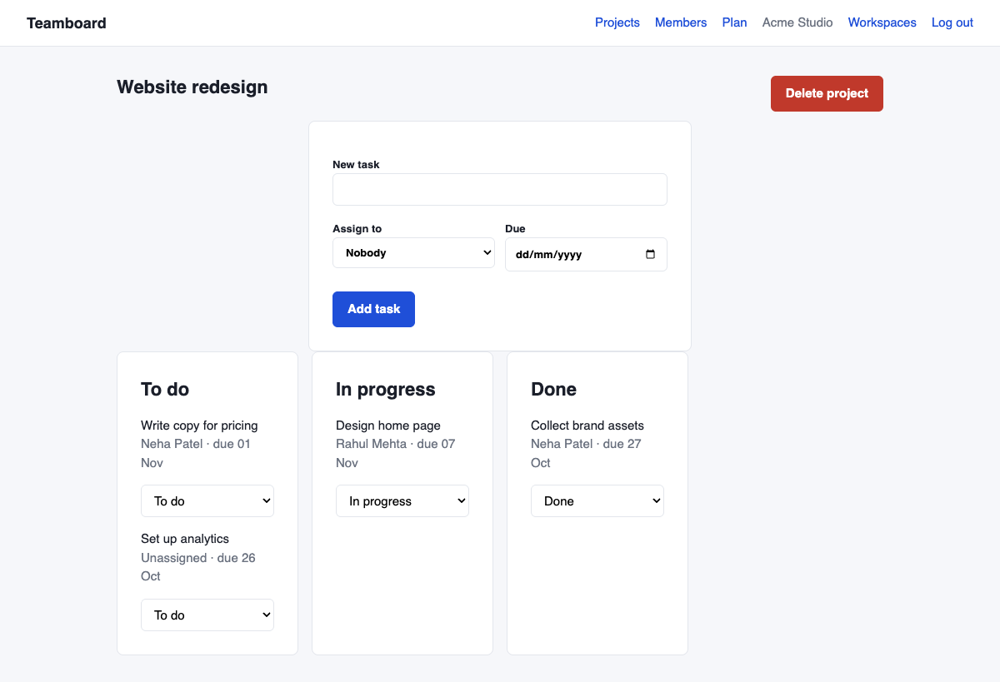
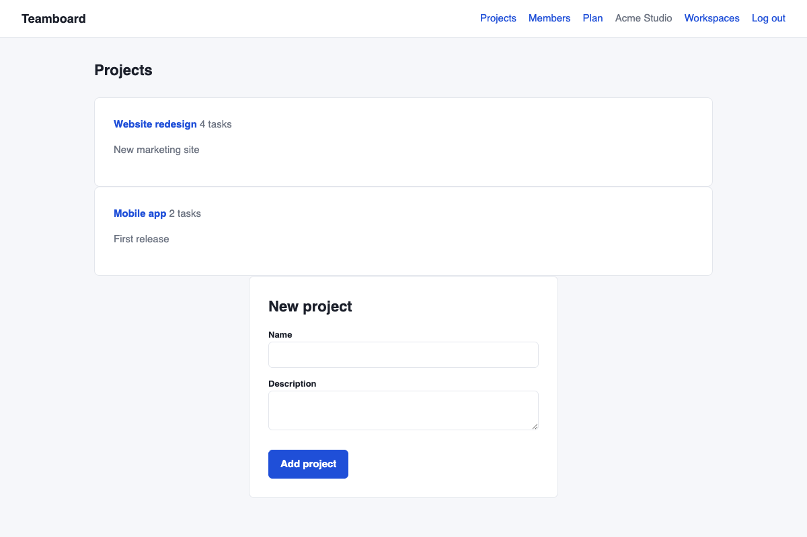
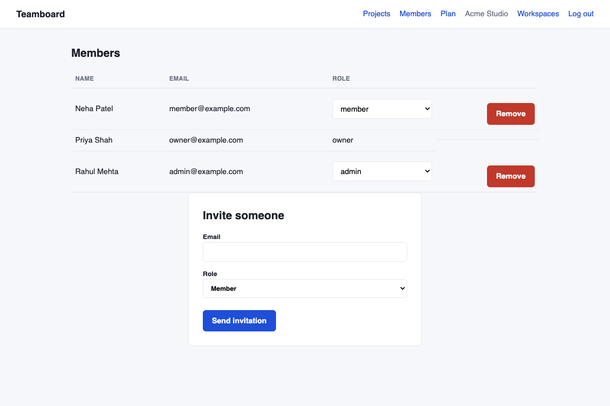
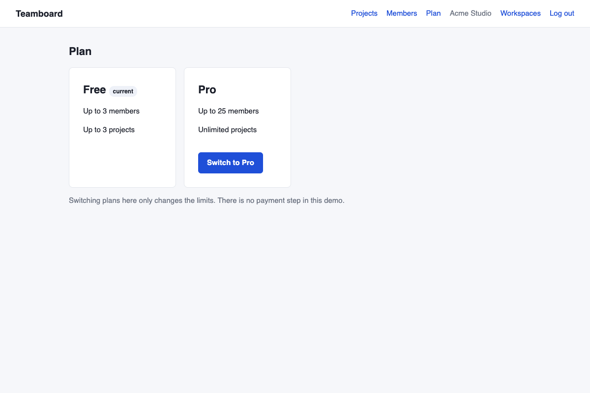

# Teamboard

A small multi-workspace task board built with Laravel 12. One user can belong to several workspaces, each workspace has its own members, projects and tasks, and the data of one workspace is never visible in another. It is a portfolio project and is not based on any client or employer code.



## What it does

- **Workspaces.** Create a workspace and you become its owner. Switch between the workspaces you belong to.
- **Roles per workspace.** Owner, admin and member. The same person can be an owner in one workspace and a plain member in another.
- **Projects and tasks.** A board per project with To do / In progress / Done, optional assignee and due date.
- **Invitations.** Admins invite people by email. The link works for 7 days, only for the invited address, and only once. People without an account are sent to register first.
- **Plans with limits.** Free allows 3 members and 3 projects, Pro allows 25 members and unlimited projects. Pending invitations count towards the member limit. Switching plan is just a button, there is no payment step.

| Projects | Members | Plan |
|---|---|---|
|  |  |  |

## Who can do what

| | Member | Admin | Owner |
|---|---|---|---|
| See projects, add and move tasks | yes | yes | yes |
| Create and delete projects | | yes | yes |
| Invite and remove people | | yes | yes |
| Change roles, change plan | | | yes |

## How the data is kept apart

Projects and tasks have a `workspace_id`. They use a small trait, `BelongsToWorkspace`, that adds a global scope (`where workspace_id = current workspace`) and fills in `workspace_id` when a record is created. A middleware works out the current workspace from the session, checks the user really is a member, and stores it in a small service. See [docs/HOW-IT-WORKS.md](docs/HOW-IT-WORKS.md) for the details and the one ordering trap in route model binding.

## Running it

```bash
composer install
cp .env.example .env && php artisan key:generate
touch database/database.sqlite
php artisan migrate --seed
php artisan serve
php artisan queue:work   # only needed to send the invitation emails
```

Emails are written to `storage/logs/laravel.log` by default. Demo logins (password `password`): `owner@example.com`, `admin@example.com`, `member@example.com`.

## Tests

```bash
php artisan test
```

23 feature tests on in-memory SQLite: tenant isolation, role rules, plan limits and the invitation flow. CI runs Pint and the tests on PHP 8.2 and 8.3.
